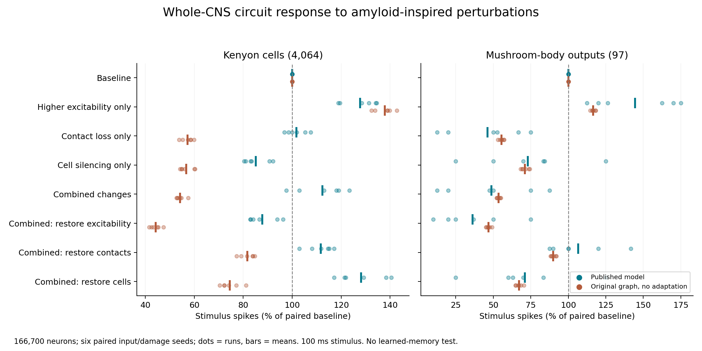
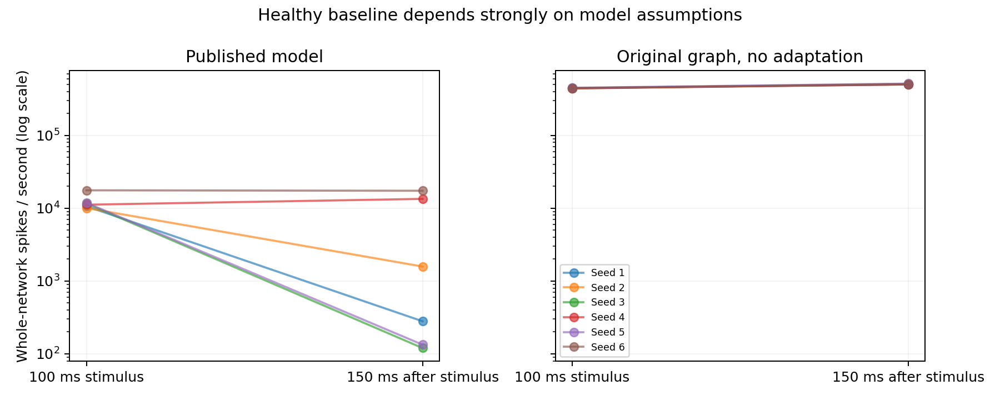

# Completed whole-CNS component experiment

**Question:** How do higher excitability, contact loss and cell silencing change an odor-evoked response in the full fly CNS?

Used the unmodified [Jo adfly-connectome engine](https://github.com/taehojo/adfly-connectome), commit `dcc143ec703d297739bf92f825b20dceea232505`, with its default adaptation and antennal-lobe connection suppression. This is a new controlled assay using that engine, not a reproduction of the preprint's disease cohorts.

**Completed:** 54 reference-model trials (nine conditions × six paired seeds), six exact full-restoration checks, and 54 trials on the original signed graph using Brian2. Each trial includes all 166,700 neurons, 50 ms quiet, 100 ms input and 150 ms washout. These are simulation seeds, not animals.



## Results

MBON spikes below are summed across all 97 mushroom-body output neurons during the 100 ms stimulus. Percentages are means of six within-seed ratios, not ratios of pooled means. Ranges describe run variability, not confidence intervals.

| Condition | Mean spikes | Mean % of paired baseline | Range (%) |
|---|---:|---:|---:|
| Baseline | 11.17 | 100.0 | 100.0–100.0 |
| Higher excitability only | 16.00 | 144.4 | 112.5–175.0 |
| Contact loss only | 5.33 | 46.1 | 12.5–75.0 |
| Cell silencing only | 8.33 | 72.9 | 25.0–125.0 |
| Combined changes | 5.50 | 48.7 | 12.5–87.5 |
| Combined: restore excitability | 4.00 | 36.1 | 10.0–75.0 |
| Combined: restore contacts | 12.00 | 106.5 | 87.5–141.7 |
| Combined: restore cells | 7.83 | 71.1 | 25.0–125.0 |

Combined changes reduced the stimulus response in every reference seed. Restoring contacts raised that response in every paired seed, sometimes above baseline. Restoring excitability alone usually lowered it further. This means spike response is not a monotonic measure of disease severity; these parameter reversals are not treatment predictions.

Baseline MBON responses were sparse (8–19 spikes), so percentage changes can be large. The original-graph comparator had roughly 822 baseline spikes on average: the model assumptions change the operating regime substantially.



Post-stimulus activity did not reliably disappear across seeds, even with the reference defaults. The single-seed diagnostic that became silent was therefore not representative of all runs. Washout rates are normalized for its longer duration; this plot does not measure memory retention.

## Perturbations and checks

The same 4,064 annotated Kenyon cells were eligible for a 1 mV threshold reduction, independent 30% thinning of outgoing synaptic contacts, and independent 17% cell-silencing probability. The threshold and contact magnitudes are assumed sensitivity settings. The cell-loss setting is approximately anchored to Ping et al. Fig. 7B, but silencing is not physical degeneration and the experimental cell selection is not identical. This replaces the reference paper's hub-ranked severity distribution with a KC-targeted component design. Input events, lost contacts and silenced IDs are paired across conditions and engines; input neurons are protected.

Both cohorts passed complete-output, unique-row, zero-input and quiet-preperiod checks. The reference runner confirmed silenced cells emitted no spikes and all six complete restorations reproduced baseline neuron counts exactly. The Brian2 implementation passed 21 targeted automated tests including its adapter. Prepared arrays matched the reference author's four numerical hashes; analysis of 159 stored reference facts reproduced exactly. These are execution/provenance checks, not disease validation.

## What this says about Alzheimer's

It demonstrates how specified amyloid-inspired circuit disturbances interact in this model. It does not simulate amyloid or tau chemistry, learn an odor association, measure hours-long forgetting, or predict human Alzheimer's. The model's optional plasticity rule was not invoked in this component assay. A separate [biological benchmark](../../research/biological_benchmarks/README.md) contains 371 published measurements for testing future retention models; [the biological memory chart](../../research/biological_benchmarks/published_memory.png) is experimental data, not this simulation.

## Reproduce and audit

Follow [reference setup](../../research/REFERENCE_REPRODUCTION.md) and [whole-CNS data setup](../../WHOLE_BRAIN.md). Preserve existing result folders before rerunning because runners refuse to overwrite them. Run:

```sh
python run_amyloid_assay.py --repeats 6 --output results/amyloid_components
NUMBA_NUM_THREADS=2 python research/run_reference_components.py
python summarize_amyloid_assay.py
```

The first command uses the Brian2 Python 3.10 environment; the reference command uses Python 3.11 with Numba. Source commits, actual runner hashes, shared draw hashes, model parameters and full-restoration checks are in [summary.json](summary.json). See [readouts.csv](readouts.csv), [aggregates](aggregate.json), [native-graph outputs](../amyloid_components/summary.json), and [independent design audit](../../research/design_audit.md). Raw inputs, damage draws and native per-neuron counts are retained.
