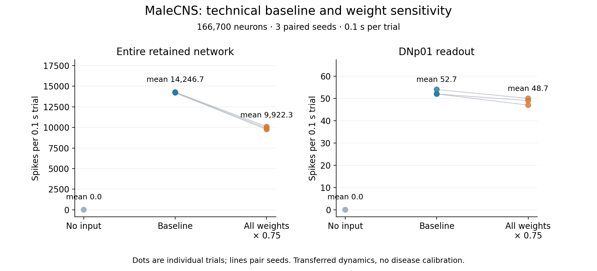

# MaleCNS technical baseline

The full retained graph executed with 166,700 neurons,
25,582,938 directed neuron-pair connections and
124,177,617 measured contacts. Every neuron was present
in every run. Each condition used 3 independent trials of 0.1 seconds;
seeds were paired across conditions. The inputs stimulate 126
LC4 neurons at 150 Hz per neuron.

Means across trials (individual values are in [trials.csv](trials.csv)):

| Condition | Total spikes | Active neurons | Spikes outside stimulated cells | Readout spikes |
|---|---:|---:|---:|---:|
| no_stimulus | 0.0 | 0.0 | 0.0 | 0.0 |
| baseline | 14,246.7 | 3,147.3 | 12,046.3 | 52.7 |
| weights_75_percent | 9,922.3 | 2,156.0 | 7,862.0 | 48.7 |

The no-input control remained silent. Input drove activity beyond the stimulated
cells and reached the named DNp01 readout. Uniform 25% weight
reduction lowered mean total spike count by 30.4% in this configuration.
This intervention weakens both excitation and inhibition. It is a model sensitivity
result, not a measurement of Alzheimer's damage or behavior.

The stimulus is artificial, the duration is short, and the Shiu dynamics were
transferred from FlyWire without calibration to MaleCNS. Transmitter signs are
simplified; 11,609 cells have zero modeled output
sign because modulatory/unknown effects are unimplemented. No learning, memory,
amyloid, tau, glial response, body behavior or human disease was tested.

Data: [official MaleCNS v1.0](https://male-cns.janelia.org/download/),
CC BY 4.0, FlyEM/HHMI Janelia, Cambridge, MRC LMB and Google Research.
See [summary.json](summary.json) for source hashes, filters, parameters and
individual trials, and [source review](../../SOURCE_REVIEW.md) for project selection.
