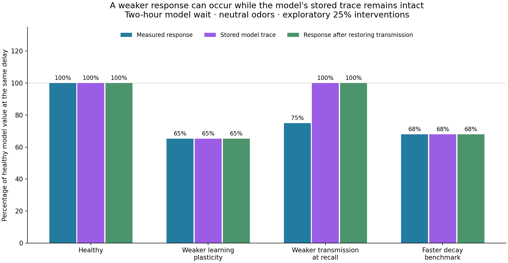

# First experiment: executed results

Completed: 2026-10-24T09:55:28.312048+00:00. This is an exploratory computational experiment in a published three-module fly memory model. It is not a whole-fly emulation, an animal experiment, or a calibrated simulation of Alzheimer's disease.

## Main finding

In this model, a smaller learned neural response can reflect reduced expression of an intact synaptic trace, reduced formation of that trace, or accelerated trace decay. The observed response alone does not uniquely identify the mechanism.

After a two-hour model wait, reducing effective KC-to-MBON transmission by 25% only during recall reduced the primary response from 18.74 to 14.05 Hz. The stored trace was unchanged. Restoring transmission recovered the response without additional training. This intervention also reduces general odor responsiveness: it is a demonstration of an output confound, not proof of a selective biological retrieval disorder.

| Condition | Measured response | Stored trace | Response after transmission is normal |
|---|---:|---:|---:|
| Healthy | 100.0% | 100.0% | 100.0% |
| Weaker learning plasticity | 65.3% | 65.3% | 65.3% |
| Weaker transmission at recall | 75.0% | 100.0% | 100.0% |
| Faster decay benchmark | 68.0% | 68.0% | 68.0% |

Values are relative to the healthy model at the same delay, using the mean fitted parameters and neutral odors. These percentages are neither behavioral accuracy nor predicted human memory performance. Restoring transmission means probing the same saved state with the transmission manipulation absent; it is not a treatment experiment.

## Healthy-model verification

The Python translation matched **1,944 numeric entries** in the authors' saved Figure 5d. Maximum absolute difference: **7.11e-15 Hz** against a 1e-8 Hz tolerance. This verifies reproduction of that saved figure, not every published result or independent biological validity. An analytic check also covers the model's change in decay time constant at three hours.

The original MATLAB implementation and fitted parameter files are preserved in `../upstream`, pinned to commit `5d7c08a9a88f923169a0c3008aca68af421e9a7f`. We did not run MATLAB or refit parameters. [Authors' model and source](https://github.com/schnitzer-lab/Luo_Huang_2024_MB_model).

## What ran

- 49 conditions: healthy, plus four mechanisms × four phases × three strengths.
- Six waiting intervals, three odor-valence settings, and three MBON output measures: 2,646 readouts.
- 100 parameter draws from the authors' supplied samples, eight selected conditions and three delays: 7,200 additional readouts.
- 6,564 paired/unpaired model simulations in those sweeps, plus controls.
- 294 control readouts: swapped odor labels gave zero discrepancy; disabling plasticity gave zero learned response after subtracting the matched unpaired condition.

The configuration was saved before the perturbation runs. Strengths were exploratory; none were fitted to Alzheimer's data. The six-hour interval was reserved as an additional check, with no fitting performed at any interval. See [methods](../METHODS.md) for the phase definitions and measurements.

## Can the model imitate preserved early performance and poorer delayed performance?

We screened for an immediate response within 90–110% of healthy and a two-hour response at most 80% of healthy, retaining the same response sign and requiring a healthy signal of at least 1 Hz. These are exploratory thresholds, not biological cutoffs.

At the mean parameters, the 25% recall-transmission manipulation qualified: 90.3% initially, 75.0% at two hours, and 75.0% at six hours. Yet its stored trace was unchanged at every delay. The apparent delay dependence arises from the nonlinear, bounded response measure and odor adaptation, rather than additional loss of the stored trace.

This pattern is not robust to all parameter choices. For example, recall-transmission met the screen in only 50 of 100 supplied parameter draws. The table reports sensitivity across those draws; the intervals are 10th–90th percentiles, **not confidence intervals from animals or people**.

| Selected intervention | Draws matching the early/delayed screen | Two-hour response ratio, median (10th–90th percentile) |
|---|---:|---:|
| decay_benchmark / persistent | 100/100 | 0.609 (0.561–0.644) |
| decay_benchmark / waiting | 100/100 | 0.684 (0.642–0.716) |
| plasticity / learning | 30/100 | 0.653 (0.639–0.662) |
| tonic_dopamine / learning | 0/100 | 1.000 (0.889–1.000) |
| tonic_dopamine / waiting | 0/100 | 1.000 (1.000–1.000) |
| transmission / learning | 0/100 | 0.870 (0.852–0.882) |
| transmission / recall | 50/100 | 0.750 (0.750–0.750) |

Changing innate odor valence also changes the pattern. At valence −3, the recall-transmission ratios were 75.0% immediately and 99.8% at two hours. Thus the neutral-odor result must not be treated as a universal outcome.

Shortening decay constants produced preserved initial response and lower delayed response, as expected from directly changing a forgetting parameter. That benchmark cannot identify what causes forgetting. Some changes applied during learning also met the screen under parameter variation, reinforcing the ambiguity of response-only measures.

## A limitation exposed by the runs

Transmission, plasticity, and tonic dopamine changes confined to silent waiting did not change the trace. In the source model, waiting has no Kenyon-cell odor input and its plasticity update is gated by that input. Its stored traces change during silent waiting through explicit decay. This is a structural limitation, not evidence that those processes are irrelevant during biological memory retention.

The tonic-dopamine extension is an exploratory common drive to the three modeled DAN variables. It does not simulate sleep, spontaneous Kenyon-cell activity, molecular forgetting pathways, or Alzheimer's-related hyperexcitability in full.

## What this contributes to understanding humans

The useful hypothesis is about measurement: poor recall need not, by itself, tell us whether a memory was weakly formed, lost during retention, or poorly expressed. Human comparisons should control initial learning and measure delayed free recall, cued recall or recognition, alongside relevant biological evidence. Restoring model transmission is not equivalent to giving a person a cue.

Human evidence supports separating these components, but does not validate this fly model's mechanism. In a study of 37 people with probable Alzheimer's disease, hippocampal volume was associated with retention after accounting for initial recall. The authors also noted limited ability to control additional demographic factors. [Human retention study](https://pmc.ncbi.nlm.nih.gov/articles/PMC1820856/)

A separate human study found that combined free and cued recall was more impaired in Alzheimer's than in non-Alzheimer dementias. This is a reason to test storage-related explanations, rather than conclude that Alzheimer's memory problems are simply a recoverable output failure. [Human free/cued recall study](https://pmc.ncbi.nlm.nih.gov/articles/PMC2929322/)

The motivating fly study observed preserved immediate performance with lower later performance under restricted amyloid-beta expression, but could not exclude impaired consolidation. Our screen resembles that pattern qualitatively; we did not fit or independently predict its experimental data. [Fly Alzheimer's study](https://journals.plos.org/plosbiology/article?id=10.1371/journal.pbio.3001412)

There are no disease-specific amyloid/tau dynamics, glial mechanisms, neuronal death, or human anatomical mappings in this implementation. The next scientific step is to constrain a specific cellular disturbance with measured fly data and test an intervention or time point not used to set its parameters. A disease mechanism has not been established by this pilot.

## Files

- [Compact figure](memory_vs_response.png) and [all four mechanism plots](phase_comparison.png).
- [Baseline reproduction](baseline_validation.png), [numeric comparison](baseline_validation.json).
- [All mean-parameter results](phase_sweep.csv), [parameter sensitivity](parameter_sensitivity.csv), [controls](controls.csv).
- [Run configuration](config_used.json), [run manifest](run_manifest.json), [pattern screen](pattern_screen.json).
